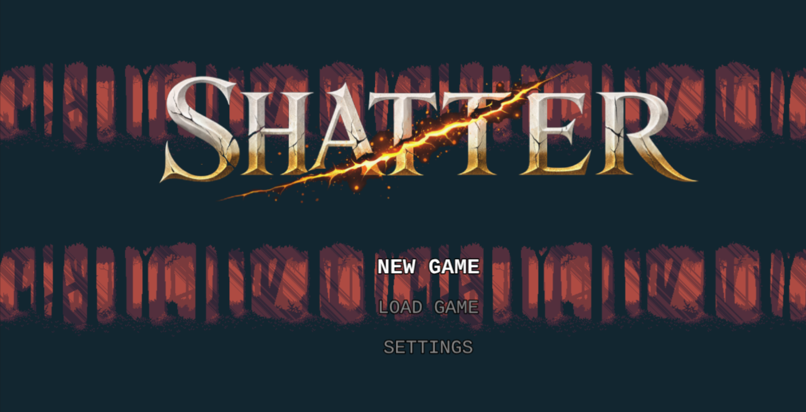
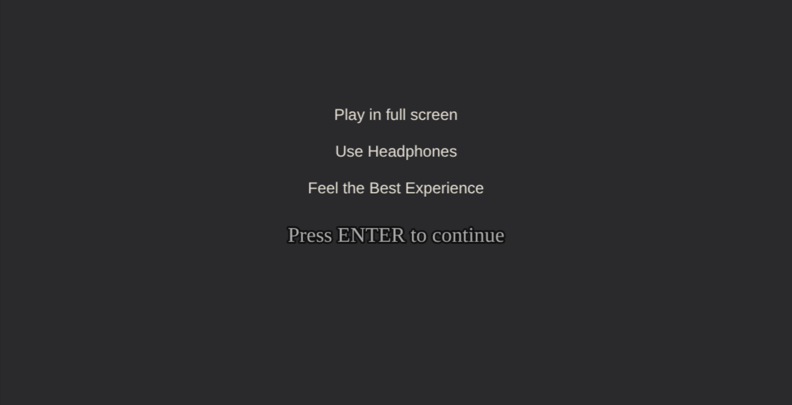

# Shatter

This is a Phaser 3 project template that uses Vite and Bun for bundling. It supports hot-reloading for quick development workflow, includes TypeScript support and scripts to generate production-ready builds.

### Versions

This template has been updated for:

- [Phaser 3.90.0](https://github.com/phaserjs/phaser)
- [Vite 6.3.1](https://github.com/vitejs/vite)
- [TypeScript 5.7.2](https://github.com/microsoft/TypeScript)

## Screenshots

## Requirements

[Bun](https://bun.sh) is required to install dependencies and run scripts via `bun`.

## Available Commands

| Command | Description |
|---------|-------------|
| `bun install` | Install project dependencies |
| `bun run dev` | Launch a development web server |
| `bun run build` | Create a production build in the `dist` folder |
| `bun run dev-nolog` | Launch a development web server without sending anonymous data (see "About log.js" below) |
| `bun run build-nolog` | Create a production build in the `dist` folder without sending anonymous data (see "About log.js" below) |

